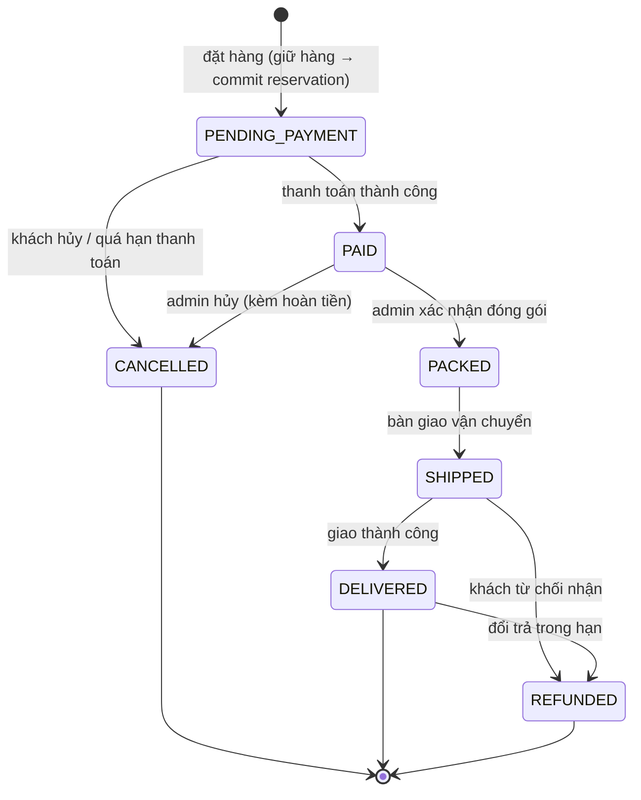
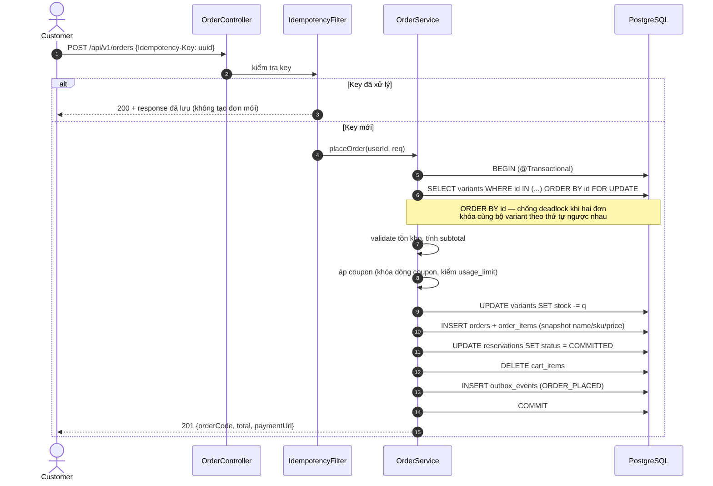
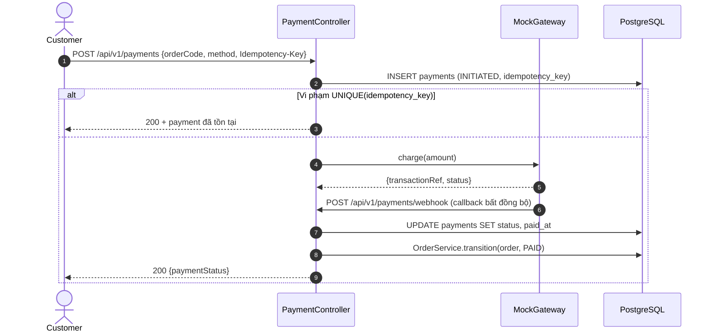
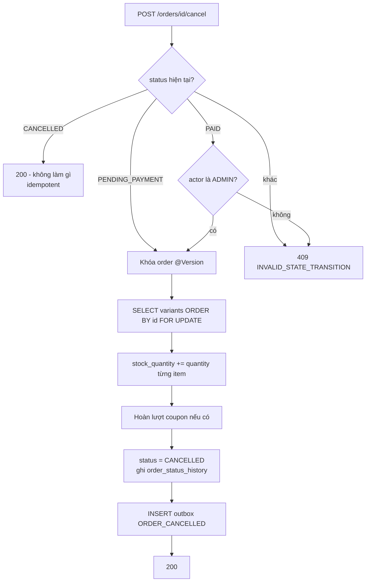

# Luồng nghiệp vụ & State Machine

> Tài liệu này trả lời câu hỏi "chuyện gì xảy ra theo thứ tự nào" — thứ mà bản đặc tả entity/API không nói được.
> Các sơ đồ dùng cú pháp Mermaid (xem `huong-dan-mermaid.md`). Copy thẳng vào README khi đóng gói.

---

## 1. State machine đơn hàng



### Bảng chuyển trạng thái — nguồn sự thật khi code

Mọi lệnh đổi trạng thái phải đi qua **một** method `OrderService.transition(orderId, toStatus, actor)`, method này tra bảng dưới. Không rải logic `if (status == ...)` khắp nơi.

| Từ | Sang | Ai được phép | Điều kiện | Tác dụng phụ |
|---|---|---|---|---|
| — | `PENDING_PAYMENT` | CUSTOMER | Giỏ không rỗng, mọi variant còn đủ tồn | Commit reservation, trừ `stock_quantity`, dọn giỏ, ghi outbox `ORDER_PLACED` |
| `PENDING_PAYMENT` | `PAID` | Hệ thống (webhook thanh toán) | `payment.status = SUCCEEDED`, số tiền khớp `total_amount` | Ghi outbox `ORDER_PAID` (gửi mail), tăng `coupon.used_count` |
| `PENDING_PAYMENT` | `CANCELLED` | CUSTOMER / hệ thống (job quá hạn 30 phút) | — | **Hoàn `stock_quantity`**, nhả reservation, hoàn lượt coupon |
| `PAID` | `PACKED` | STAFF / ADMIN | — | Gán serial cho từng `order_item` (nếu bật tính năng serial) |
| `PAID` | `CANCELLED` | ADMIN | — | Hoàn kho + tạo bản ghi `payment` hoàn tiền |
| `PACKED` | `SHIPPED` | STAFF / ADMIN | — | Ghi outbox `ORDER_SHIPPED` |
| `SHIPPED` | `DELIVERED` | STAFF / ADMIN | — | Mở quyền review cho các `order_item` |
| `SHIPPED` | `REFUNDED` | ADMIN | — | Hoàn kho, hoàn tiền, serial về `RETURNED` |
| `DELIVERED` | `REFUNDED` | ADMIN | Trong 7 ngày kể từ `delivered_at` | Như trên |

**Mọi chuyển đổi không có trong bảng → `409 INVALID_STATE_TRANSITION`.** Mọi chuyển đổi thành công → ghi một dòng `order_status_history`.

> **Bẫy cần xử lý:** khách bấm hủy đúng lúc admin bấm chuyển sang `PACKED`. Hai transaction cùng đọc `PAID`, cả hai cùng thấy hợp lệ. Chặn bằng `@Version` trên `orders` (optimistic lock) — người thua nhận `409`, không phải bằng cách kiểm tra lại trong code. Đây là câu hỏi phỏng vấn rất hay để tự đặt ra và trả lời trong README.

---

## 2. Luồng checkout — giữ hàng (reservation)

```mermaid
sequenceDiagram
  autonumber
  actor U as Customer
  participant API as CheckoutController
  participant S as ReservationService
  participant R as Redis
  participant DB as PostgreSQL

  U->>API: POST /api/v1/checkout/sessions
  API->>S: hold(cartItems, userId)
  S->>DB: BEGIN
  loop mỗi cart item
    S->>DB: SELECT ... FOR UPDATE (variant)
    alt available = stock - reserved < quantity
      S-->>API: 409 INSUFFICIENT_STOCK (kèm variantId)
    else đủ hàng
      S->>DB: UPDATE variants SET reserved_quantity += q
      S->>DB: INSERT inventory_reservations (HELD, expires_at = now + 10m)
    end
  end
  S->>DB: COMMIT
  S->>R: SETEX resv:{id} 600 "1"  (đường nhanh, best-effort)
  S-->>U: 201 {checkoutSessionId, expiresAt, summary}

  Note over U,DB: Khách có 10 phút để thanh toán

  alt Thanh toán trong hạn
    U->>API: POST /api/v1/orders (Idempotency-Key)
    API->>S: commit(reservationIds)
    S->>DB: UPDATE variants SET stock -= q, reserved -= q
    S->>DB: UPDATE reservations SET status = COMMITTED
  else Hết hạn
    Note over DB: @Scheduled mỗi 30s
    DB->>DB: SELECT ... WHERE status=HELD AND expires_at < now() LIMIT 500
    DB->>DB: UPDATE variants SET reserved -= q; reservations SET status = EXPIRED
  end
```

### Ba quyết định trong sơ đồ này cần bảo vệ được

1. **DB là nguồn sự thật, Redis chỉ là đường nhanh.** Cách ngược lại (Redis giữ trạng thái, dùng keyspace notification để nhả hàng) nghe hiện đại hơn nhưng mất reservation khi Redis restart, và keyspace notification là *at-most-once* — mất event là hàng bị giữ vĩnh viễn. Job `@Scheduled` quét DB thì chậm hơn vài chục giây nhưng **không bao giờ mất**.
   → *"Redis chết thì sao?"* — hệ thống vẫn đúng, chỉ mất phần cache; job DB vẫn nhả hàng bình thường. Đây là câu trả lời mà interviewer muốn nghe.

2. **Job quét theo lô có `LIMIT`.** Không `UPDATE ... WHERE expires_at < now()` một phát trên toàn bảng — lô lớn khóa lâu và có thể timeout. Quét 500 dòng mỗi lượt.

3. **Nhả hàng phải idempotent.** Job có thể chạy chồng nếu lượt trước chưa xong. Dùng `UPDATE ... WHERE status = 'HELD'` (điều kiện trong câu lệnh), kiểm số dòng bị ảnh hưởng, chứ không đọc-rồi-ghi.

---

## 3. Luồng đặt hàng — nơi chống oversell



### `ORDER BY id ... FOR UPDATE` — chi tiết nhỏ, giá trị lớn

Đơn A mua `[variant 5, variant 9]`, đơn B mua `[variant 9, variant 5]`. Nếu khóa theo thứ tự client gửi, A giữ 5 chờ 9 còn B giữ 9 chờ 5 → **deadlock**. Sắp xếp theo `id` trước khi khóa làm mọi transaction khóa cùng một thứ tự, deadlock biến mất.

Đây là loại chi tiết cho thấy bạn đã thực sự nghĩ về đồng thời chứ không chỉ dán annotation `@Transactional`. Nhớ đưa vào README.

### Chọn khóa nào

| Cách | Dùng ở đâu | Vì sao |
|---|---|---|
| **Pessimistic** (`FOR UPDATE`) | Đặt hàng thường | Tranh chấp thấp nhưng phải đúng tuyệt đối; retry logic phức tạp không đáng |
| **Optimistic** (`@Version`) | Đổi trạng thái đơn, sửa coupon | Tranh chấp hiếm; người thua nhận `409` là hành vi đúng về nghiệp vụ |
| **Redis atomic** (Lua) | Flash sale | Vài nghìn request/giây vào cùng một dòng — DB không chịu nổi dù khóa kiểu gì |

Ba dòng này là bộ khung câu trả lời cho câu hỏi phỏng vấn kinh điển. Điểm mấu chốt không phải "biết ba cách", mà là **giải thích được vì sao mỗi chỗ dùng một cách khác nhau**.

---

## 4. Luồng flash sale

```mermaid
sequenceDiagram
  autonumber
  actor U as Nhiều Customer
  participant RL as RateLimitFilter (Bucket4j)
  participant F as FlashSaleController
  participant R as Redis
  participant OB as Outbox worker
  participant DB as PostgreSQL

  Note over R: Trước giờ mở bán: nạp sẵn<br/>fs:{itemId}:stock = sale_quantity

  U->>RL: POST /api/v1/flash-sales/{id}/purchase
  alt Vượt giới hạn (10 req/phút/user)
    RL-->>U: 429 + Retry-After
  else Trong giới hạn
    RL->>F: forward
    F->>R: EVAL luaScript(itemId, userId, qty)
    Note over R: Lua chạy nguyên tử:<br/>1. kiểm still RUNNING<br/>2. kiểm user chưa vượt per_user_limit<br/>3. kiểm stock >= qty<br/>4. DECRBY stock; INCR user counter
    alt Lua trả -1
      R-->>U: 409 SOLD_OUT
    else Lua trả -2
      R-->>U: 409 FLASH_SALE_LIMIT_EXCEEDED
    else Lua trả tồn còn lại
      F->>DB: INSERT orders (PENDING_PAYMENT) + outbox FLASH_SALE_SOLD
      F-->>U: 201 {orderCode}
    end
  end

  OB->>DB: đọc outbox PENDING
  OB->>DB: UPDATE flash_sale_items SET sold_quantity += q
```

**Vì sao phải là Lua script, không phải `DECR` rồi kiểm tra?** `DECR` rồi thấy âm rồi `INCR` bù lại là một chuỗi ba lệnh không nguyên tử — giữa chúng có request khác chen vào và đọc phải tồn kho âm. Lua chạy trên Redis như một lệnh duy nhất, không có khe hở.

**Vì sao không dùng `synchronized` trong Java?** `synchronized` chỉ khóa trong một JVM. Deploy 2 instance là nó vô dụng ngay. Câu này gần như chắc chắn được hỏi — chuẩn bị sẵn.

**Redis và DB lệch nhau thì sao?** Redis là nguồn sự thật *trong phiên flash sale*; DB được đồng bộ qua outbox và là bản ghi cuối cùng. Kết thúc phiên, chạy đối soát: `sold_quantity` trong DB phải bằng `sale_quantity - stock còn lại trên Redis`. Lệch thì log cảnh báo. Thừa nhận thẳng đây là **eventual consistency có chủ đích**, đổi lấy throughput.

---

## 5. Luồng thanh toán (mock) + idempotency



**Idempotency chốt ở DB, không chốt ở Redis.** Redis dùng làm lớp chặn nhanh, nhưng ràng buộc `UNIQUE` trên `payments.idempotency_key` mới là thứ đảm bảo đúng khi Redis mất dữ liệu. Cùng một triết lý với reservation ở mục 2: **hạ tầng nhanh có thể mất, nguồn sự thật thì không.**

Webhook cũng phải idempotent — cổng thanh toán thật gửi lại callback khi không nhận được `200`. Chặn bằng `UNIQUE(transaction_ref)`.

---

## 6. Luồng hủy đơn + hoàn kho



Nhánh `CANCELLED → 200 không làm gì` là **chỗ dễ sai nhất trong toàn dự án**. Thiếu nó, khách bấm hủy hai lần sẽ được hoàn kho hai lần và tồn kho bị thổi phồng. Đây phải là một test case riêng, đặt tên rõ ràng: `cancelTwice_shouldRestoreStockOnlyOnce()`.

---

## 7. Xử lý bất đồng bộ bằng Outbox

```mermaid
sequenceDiagram
  autonumber
  participant S as OrderService
  participant DB as PostgreSQL
  participant W as OutboxWorker
  participant M as MailSender

  S->>DB: BEGIN
  S->>DB: INSERT orders
  S->>DB: INSERT outbox_events (ORDER_PLACED, PENDING)
  S->>DB: COMMIT
  Note over S,DB: Đơn hàng và event cùng một transaction<br/>→ không thể có đơn mà thiếu event

  loop mỗi 5 giây
    W->>DB: SELECT * FROM outbox_events<br/>WHERE status=PENDING ORDER BY id<br/>LIMIT 100 FOR UPDATE SKIP LOCKED
    W->>M: gửi mail
    alt thành công
      W->>DB: UPDATE status = PROCESSED
    else lỗi
      W->>DB: retry_count += 1; nếu > 5 → FAILED
    end
  end
```

**Vì sao không gọi thẳng `mailService.send()` trong transaction đặt hàng?** Hai lý do: (a) gửi mail chậm và có thể lỗi — kéo dài transaction, giữ khóa dòng lâu hơn cần thiết; (b) nếu transaction rollback sau khi mail đã gửi, khách nhận mail về đơn hàng không tồn tại. Outbox giải cả hai: mail chỉ được gửi sau khi đơn đã commit chắc chắn.

**`FOR UPDATE SKIP LOCKED`** cho phép chạy nhiều instance worker song song mà không giành nhau cùng một dòng. Đây là mẹo hay để nhắc khi được hỏi "làm sao scale ngang phần này".

**Đánh đổi thừa nhận:** giao hàng *at-least-once*, mail có thể gửi trùng nếu worker chết sau khi gửi nhưng trước khi commit. Chấp nhận được với email; nếu là trừ tiền thì phải thêm khóa idempotent ở phía consumer.
