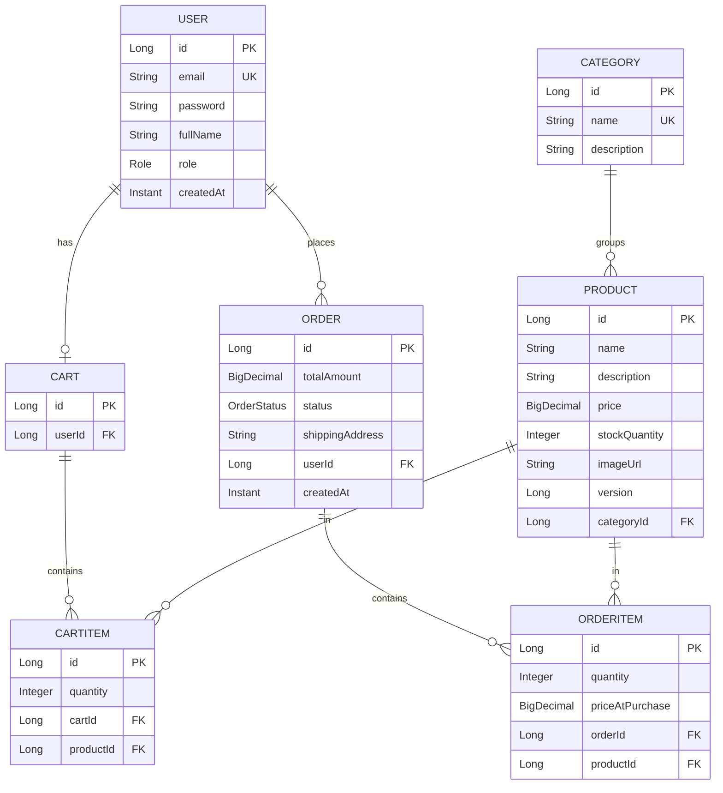

> ⚠️ **Tài liệu v1 — không code theo bản này.** Bản thiết kế thi hành là `01-domain-v2.md`. Giữ lại đây để tham khảo phần lý thuyết (BigDecimal, snapshot giá, N+1 query, optimistic lock).

# Sơ đồ quan hệ thực thể (ERD) — E-commerce Backend

Sơ đồ dưới viết bằng cú pháp Mermaid. Các trình xem Markdown hỗ trợ Mermaid (GitHub, GitLab, VS Code + plugin) sẽ tự render thành sơ đồ.

## Đọc ký hiệu quan hệ (crow's foot)

- `||--o|` — một-một (one-to-one), phía `o|` là không-bắt-buộc. Vd: một `USER` có **không hoặc một** `CART`.
- `||--o{` — một-nhiều (one-to-many). Vd: một `CATEGORY` nhóm **nhiều** `PRODUCT`; một `ORDER` chứa **nhiều** `ORDERITEM`.
- `PK` = khóa chính, `FK` = khóa ngoại, `UK` = khóa duy nhất (unique).

## Tóm tắt quan hệ

- `USER` 1 — 1 `CART`, và 1 — N `ORDER`.
- `CATEGORY` 1 — N `PRODUCT`.
- `CART` 1 — N `CARTITEM`; mỗi `CARTITEM` trỏ tới 1 `PRODUCT`.
- `ORDER` 1 — N `ORDERITEM`; mỗi `ORDERITEM` trỏ tới 1 `PRODUCT` và lưu `priceAtPurchase` (giá tại lúc mua).
- `PRODUCT.version` phục vụ khóa lạc quan (optimistic lock) khi trừ tồn kho.
