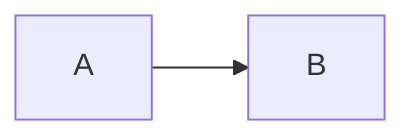

# Hướng dẫn viết Mermaid (chi tiết)

Mermaid là công cụ vẽ sơ đồ **bằng chữ**: bạn viết vài dòng text mô tả, nó tự render ra hình. Ưu điểm: sơ đồ nằm ngay trong file `.md`, version-control được bằng Git như code, sửa nhanh.

Các ví dụ dưới đây dùng dự án e-commerce làm minh họa để bạn copy được ngay.

---

## 1. Cách dùng & nơi render

Đặt sơ đồ trong một khối code có tên ngôn ngữ là `mermaid`:

````

````

**Nơi tự render thành hình:** GitHub, GitLab (hiện trực tiếp trong README), VS Code (cài extension *Markdown Preview Mermaid Support*), Obsidian, Notion. Để thử nhanh không cần cài gì: trang **mermaid.live** — gõ bên trái, thấy hình bên phải ngay.

> Lưu ý đọc tài liệu này: các ví dụ bên dưới để trong khối ``` thường (hiện ra dạng chữ để bạn học cú pháp). Khi dùng thật trong README, đổi ``` thành ` ```mermaid ` để nó vẽ ra hình.

**Comment** trong Mermaid: dòng bắt đầu bằng `%%`.

```
flowchart TD
    %% đây là chú thích, không hiện ra
    A --> B
```

---

## 2. Flowchart — sơ đồ luồng / kiến trúc

Dùng cho luồng xử lý, sơ đồ kiến trúc, cây quyết định. Bắt đầu bằng `flowchart` (hoặc `graph`) + **hướng**:

| Mã | Hướng |
|---|---|
| `TD` hoặc `TB` | trên → dưới |
| `BT` | dưới → trên |
| `LR` | trái → phải |
| `RL` | phải → trái |

### Hình dạng node

```
flowchart TD
    A[Chữ nhật]
    B(Bo góc)
    C([Hình thuốc - stadium])
    D[[Chương trình con]]
    E[(Cơ sở dữ liệu)]
    F((Hình tròn))
    G{Hình thoi - quyết định}
    H{{Lục giác}}
    I[/Hình bình hành/]
```

`id[nhãn]` — `id` là tên bạn dùng để nối, `[nhãn]` là chữ hiện ra. Cùng một `id` xuất hiện nhiều lần vẫn là một node.

### Mũi tên (cạnh nối)

```
flowchart LR
    A --> B
    A --- B
    A -.-> B
    A ==> B
    A -->|có nhãn| B
    A -- nhãn kiểu khác --> B
```

`-->` mũi tên thường, `---` đường thẳng không mũi tên, `-.->` nét đứt, `==>` nét đậm. Gắn nhãn bằng `-->|chữ|` hoặc `-- chữ -->`.

### Gom nhóm bằng subgraph

```
flowchart TD
    Client --> Filter
    subgraph "Spring Boot App"
        Filter[JWT Filter] --> Controller
        Controller --> Service
        Service --> Repository
    end
    Repository --> DB[(PostgreSQL)]
```

Khối `subgraph ... end` vẽ một khung bao quanh — đúng cách mình vẽ sơ đồ kiến trúc phân tầng cho bạn.

### Ví dụ thật: luồng đặt hàng

```
flowchart TD
    Start([Người dùng bấm Đặt hàng]) --> Cart[Lấy giỏ hàng]
    Cart --> Check{Còn đủ tồn?}
    Check -->|Có| Deduct[Trừ tồn kho]
    Check -->|Không| Err[Ném OutOfStockException]
    Deduct --> Order[Tạo Order + OrderItem]
    Order --> Clear[Dọn giỏ hàng]
    Clear --> Done([Trả về đơn hàng])
    Err --> Rollback([Rollback transaction])
```

---

## 3. Sequence diagram — sơ đồ tuần tự

Dùng khi muốn thể hiện các thành phần **trao đổi với nhau theo thời gian** (thời gian chạy từ trên xuống). Rất hợp để mô tả luồng API hay tình huống đồng thời.

```
sequenceDiagram
    participant C as Client
    participant Ct as Controller
    participant S as OrderService
    participant DB as Database

    C->>Ct: POST /api/orders
    Ct->>S: placeOrder(userId)
    S->>DB: đọc giỏ hàng
    DB-->>S: danh sách item
    S->>DB: trừ tồn + lưu đơn
    DB-->>S: OK
    S-->>Ct: OrderResponse
    Ct-->>C: 201 Created
```

**Khai báo thành phần:** `participant TÊN as Nhãn` (gọn hơn thì dùng `actor` cho người dùng).

**Các loại mũi tên:**

| Mã | Ý nghĩa |
|---|---|
| `->>` | gọi (nét liền, có đầu mũi tên) |
| `-->>` | phản hồi (nét đứt) |
| `-)` | gọi bất đồng bộ |
| `->` | nét liền không đầu mũi tên |

**Khối điều khiển** (rất mạnh):

```
sequenceDiagram
    participant S as Service
    participant DB as Database

    Note over S,DB: kiểm tra rồi trừ tồn

    loop mỗi sản phẩm trong giỏ
        S->>DB: kiểm tra tồn
    end

    alt còn đủ hàng
        S->>DB: tạo đơn
    else hết hàng
        S-->>S: ném exception
    end
```

`Note over A,B: ...` thêm ghi chú; `loop ... end` vòng lặp; `alt ... else ... end` rẽ nhánh. Đặc biệt có `par ... and ... end` để vẽ **hai luồng chạy song song** — đúng để minh họa race condition hai người mua cùng lúc.

---

## 4. ER diagram — sơ đồ quan hệ dữ liệu

Dùng cho mô hình dữ liệu (các bảng và quan hệ). Đây là cú pháp mình đã dùng cho ERD e-commerce của bạn.

```
erDiagram
    USER ||--o{ ORDER : places
    ORDER ||--o{ ORDERITEM : contains
    PRODUCT ||--o{ ORDERITEM : in

    USER {
        Long id PK
        String email UK
        Role role
    }
    ORDER {
        Long id PK
        BigDecimal totalAmount
        Long userId FK
    }
```

**Khai báo trường:** trong `{ }`, mỗi dòng là `Kiểu tên Khóa`. Khóa: `PK` (chính), `FK` (ngoại), `UK` (duy nhất).

**Ký hiệu lực lượng (cardinality)** — ghép phía trái và phía phải:

| Ký hiệu | Nghĩa |
|---|---|
| `|o` / `o|` | không hoặc một |
| `||` | đúng một |
| `}o` / `o{` | không hoặc nhiều |
| `}|` / `|{` | một hoặc nhiều |

Ví dụ `USER ||--o{ ORDER` đọc là: một `USER` có **không hoặc nhiều** `ORDER`. Phần sau dấu `:` là tên quan hệ. Dùng `--` cho quan hệ định danh, `..` cho không định danh.

---

## 5. Class diagram — sơ đồ lớp (hợp với Java)

Dùng để mô tả các class và quan hệ OOP — sát với code Java của bạn.

```
classDiagram
    class Product {
        +Long id
        +String name
        +BigDecimal price
        -int stockQuantity
        +getPrice() BigDecimal
        +reduceStock(int qty) void
    }
    class Category {
        +Long id
        +String name
    }
    Category "1" --> "*" Product : groups
```

**Tầm nhìn (visibility):** `+` public, `-` private, `#` protected, `~` package.
Trong `class { }`: dòng có `()` là method, không có là thuộc tính.

**Quan hệ:**

| Mã | Nghĩa |
|---|---|
| `<|--` | kế thừa (inheritance) |
| `*--` | hợp thành (composition) |
| `o--` | tập hợp (aggregation) |
| `-->` | liên kết (association) |
| `..>` | phụ thuộc (dependency) |
| `..|>` | hiện thực interface |

---

## 6. State diagram — sơ đồ trạng thái

Cực hợp để vẽ vòng đời `OrderStatus` trong dự án của bạn.

```
stateDiagram-v2
    [*] --> PENDING
    PENDING --> PAID: thanh toán
    PENDING --> CANCELLED: hủy
    PAID --> SHIPPED: giao hàng
    SHIPPED --> DELIVERED: nhận hàng
    DELIVERED --> [*]
    CANCELLED --> [*]
```

`[*]` là điểm bắt đầu/kết thúc. `A --> B: nhãn` là chuyển trạng thái kèm điều kiện/hành động. Sơ đồ này đưa vào README cho thấy bạn nghĩ kỹ về vòng đời đơn hàng — một điểm cộng.

---

## 7. Mẹo & công cụ

- **Thử nhanh:** trang **mermaid.live** — sửa thấy ngay, có nút export PNG/SVG.
- **Xuống dòng trong nhãn:** dùng `<br/>`. Vd `A[Dòng 1<br/>Dòng 2]`.
- **Ký tự đặc biệt trong nhãn** (dấu ngoặc, dấu hai chấm): bọc trong nháy kép — `A["Giá (VNĐ): 100"]`.
- **Tô màu node** (flowchart): dùng `style`.
  ```
  flowchart LR
      A[Lỗi] --> B[OK]
      style A fill:#fee,stroke:#c00
  ```
- **Đổi hướng nhanh** khi sơ đồ quá cao: chuyển `TD` thành `LR`.
- GitHub render Mermaid tự động trong file `.md`, không cần cấu hình gì.

---

## Tóm tắt: chọn loại sơ đồ nào

| Muốn vẽ | Dùng |
|---|---|
| Luồng xử lý, kiến trúc, cây quyết định | `flowchart` |
| Trao đổi giữa các thành phần theo thời gian | `sequenceDiagram` |
| Mô hình dữ liệu / các bảng | `erDiagram` |
| Class và quan hệ OOP | `classDiagram` |
| Vòng đời trạng thái (vd đơn hàng) | `stateDiagram-v2` |
